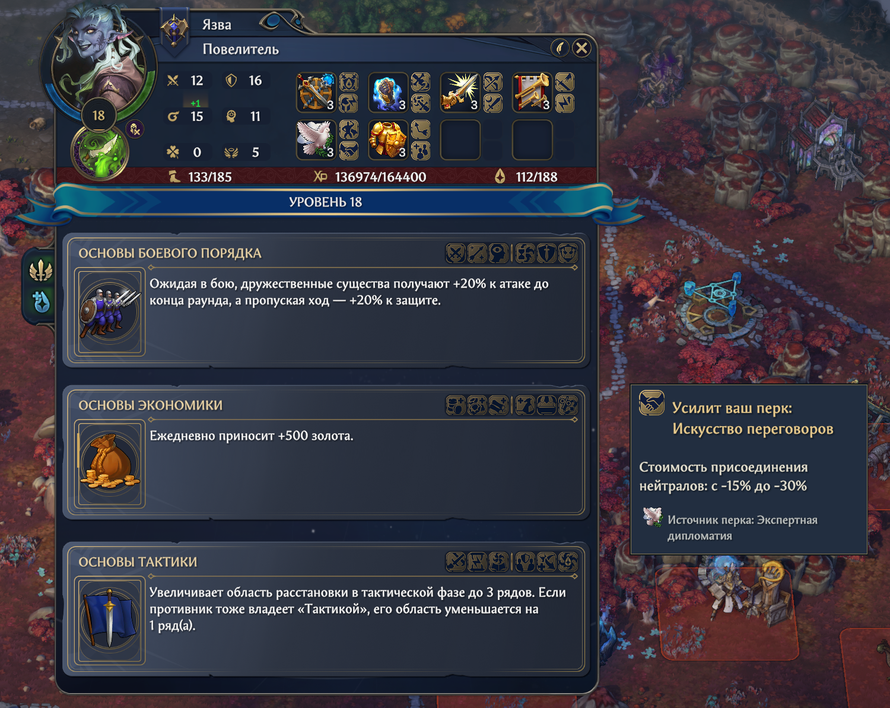
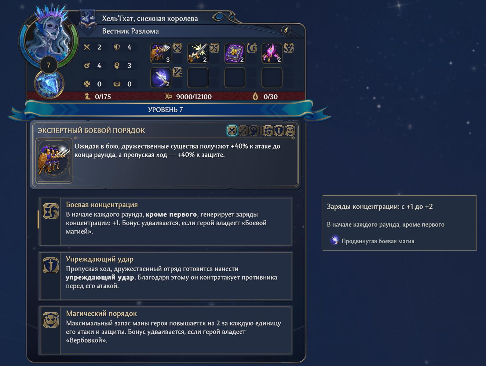

# Skill Synergies

Мод показывает сочетания навыков и перков в окне выбора при повышении уровня в Heroes of Might and Magic: Olden Era. Рядом с подходящим вариантом появляется подсказка с численным изменением эффекта, условиями действия и источником усиления.

**Версия 0.1.15.** Windows x64, Steam build 25672315, Unity 6000.0.66, BepInEx Unity.IL2CPP 6.0.0-be.788.

[Скачать установщик 0.1.15](https://github.com/yusha144/OldenEra-SkillSynergies/releases/download/v0.1.15/OldenEra-SkillSynergies-0.1.15.zip) · [Все выпуски](https://github.com/yusha144/OldenEra-SkillSynergies/releases)

Полностью распакуйте установочный архив и запустите `Install.bat` из корня, рядом с папкой `_files`. Кнопка `Code / Download ZIP` и ссылки `Source code` скачивают исходники для разработки.

[Установка и удаление](docs/installation.md) · [Настройки](docs/settings.md) · [Обратная связь](docs/feedback.md)

## Что показывает мод

- Усиление уже изученного перка при выборе предлагаемого навыка.
- Усиление предлагаемого перка за счёт имеющихся навыков героя.
- Значения эффекта до и после выбора с учётом уже действующих сочетаний.
- Общий итог и отдельные вклады, когда один эффект усиливается несколькими источниками.
- Условия действия, значки навыков и источник изученного перка на его текущем уровне.
- Подсказки в обычном окне повышения уровня и в арене.

Плашки появляются автоматически рядом с соответствующими вариантами выбора. Наведение мыши не требуется. Длинную плашку можно прокрутить колёсиком, наведя на неё курсор.

F9 скрывает и показывает подсказки в открытом окне выбора. [Изменение клавиши и начальной видимости](docs/settings.md).

## Примеры

<table>
<tr>
<td></td>
<td></td>
</tr>
<tr>
<td>Экономика и Искусство переговоров: стоимость присоединения нейтралов с -15% до -30%.</td>
<td>Боевая концентрация и Боевая магия: заряды концентрации с +1 до +2.</td>
</tr>
</table>

Полный размер открывается по нажатию на снимок.

## Установка и обновление

Распакуйте установочный архив `OldenEra-SkillSynergies-0.1.15.zip`, закройте игру и запустите `Install.bat`. Установщик определяет папку игры, проверяет совместимость и сохраняет резервную копию заменяемых файлов. Для первой установки нужен интернет.

Для обновления используйте `Install.bat` из нового архива. Настройки, общие клавиши и другие моды сохраняются. Если все файлы сборки уже установлены, повторный запуск ничего не меняет. Удаление выполняется через `Uninstall.bat`. [Подробная инструкция](docs/installation.md).

## Пожелания и ошибки

[Сообщить об ошибке](https://github.com/yusha144/OldenEra-SkillSynergies/issues/new?template=bug_report.yml) · [Предложить улучшение](https://github.com/yusha144/OldenEra-SkillSynergies/discussions/categories/ideas) · [Обсуждение](https://github.com/yusha144/OldenEra-SkillSynergies/discussions/categories/general) · [Вопрос по установке](https://github.com/yusha144/OldenEra-SkillSynergies/discussions/categories/q-a)

## Исходники и лицензия

`source/` содержит код мода, `installer/` установщик, `docs/` инструкции и снимки, `development/` сборку и проверки. [Руководство разработчика](https://github.com/yusha144/OldenEra-SkillSynergies/tree/main/development).

Автор: [yusha144](https://github.com/yusha144). Код мода, установщика и документация распространяются по [MIT](LICENSE). [Сведения о сторонних компонентах](docs/third-party-notices.md).
